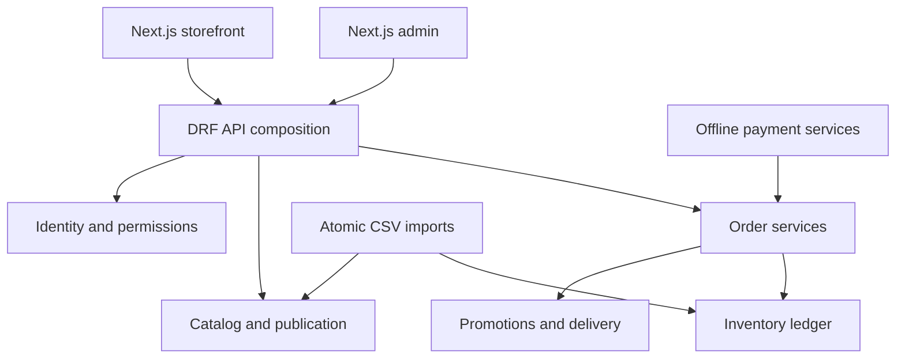

# Implementation architecture

The full target design is in `approved/`. This file explains the current code boundaries.

`config/api.py` composes the current HTTP routes and serializers. Core calculations live in `apps/*/services.py`; model constraints protect prices, SKU/combination uniqueness, stock allocations and review ranges. The composition module should be split into per-domain API packages as endpoint coverage grows; it is not the final planned 345-endpoint organization.

Catalog attributes are data. Variants select controlled attribute options using relational foreign keys. Published product payloads are separated from editable product data; cost prices are excluded from public snapshots. Stock remains live and is revalidated at checkout.

The stock equation is `available = on_hand - reserved - committed`. Pending bank orders reserve; accepted COD/verified bank orders commit; dispatch/collection decrements physical stock and commitment together. Cancellation before departure releases allocation without increasing physical stock. A refund never invokes inventory. Explicit restock is a separate bounded operation.

Checkout locks the cart, promotion counters and inventory rows in deterministic order, recalculates the quote, and commits order/items/movements/holds atomically. PostgreSQL is required to verify and rely on row-level concurrency behavior. SQLite tests verify functional rollback and state rules only.

Client identity comes from StoreSettings, not source branches. The two demo packs contain industry-specific data outside the core application. Production credentials and database contents never enter source control.
