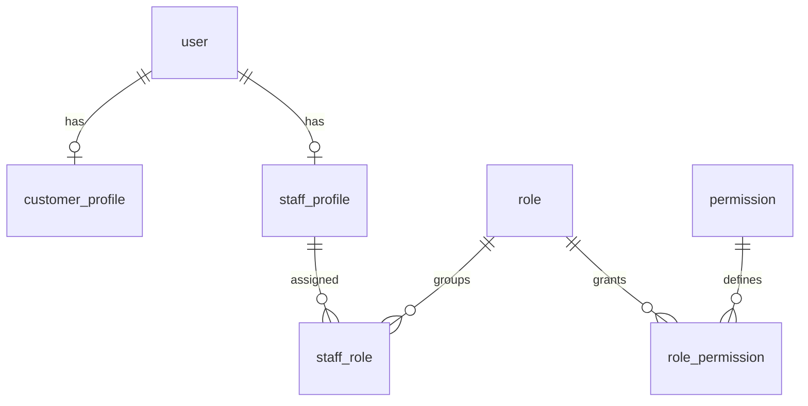
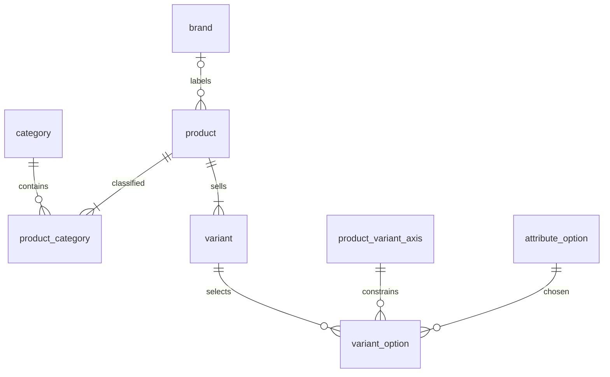
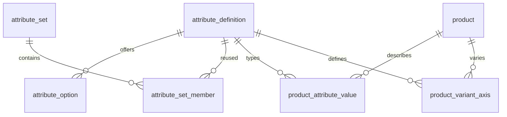
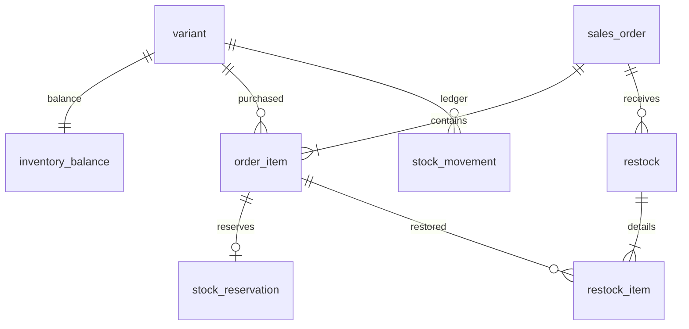
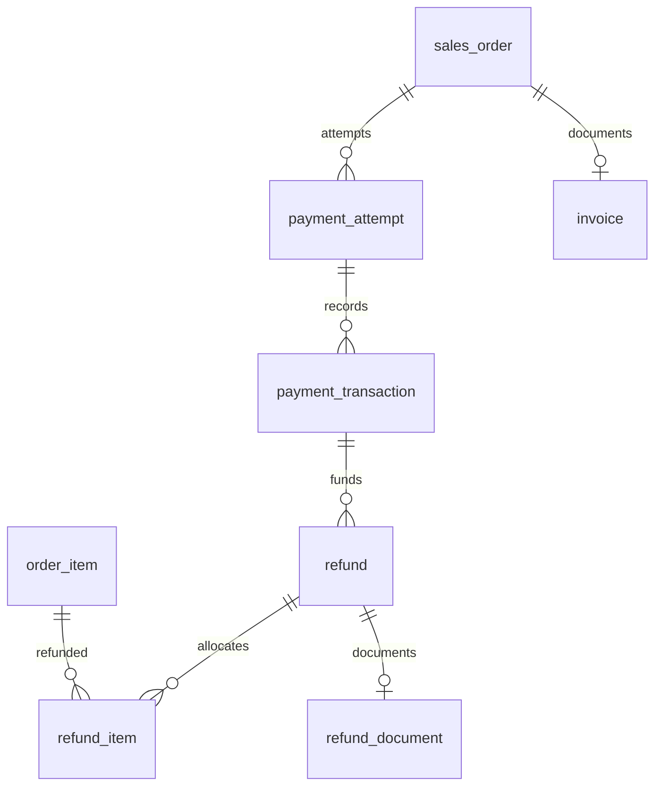
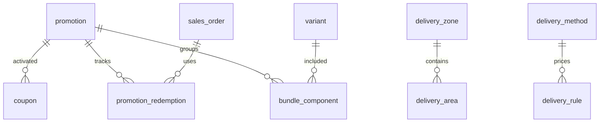
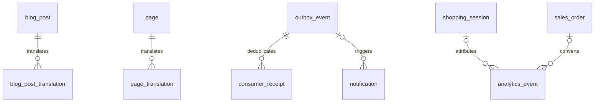

# Version 1 database ERD

The accompanying DBML contains **126 application-owned logical entities and 187 explicit foreign-key relationships**. Domain diagrams below are readable views of that complete graph, not substitute partial schemas. All UUID keys, field types, nullable fields, unique indexes and foreign keys are listed in DATABASE_SCHEMA.dbml.

**Model conventions**

- One database per client; no shared tenant table or tenant_id filter. Database credentials and storage isolation enforce deployment boundaries.
- DBML uses UUID id, created_at and updated_at on every logical entity. Append-only histories never change except controlled redaction/retention operations; updated_at is initially created_at.
- PostgreSQL FK deletes restrict. Transactional cleanup of never-published drafts may explicitly delete dependent draft rows. Paid order, ledger, invoice and stock history never cascade from product/customer deletion.
- Exact numeric money, integer quantities, UTC timestamps. Null means unknown/not applicable, not zero. Required fields without defaults must be supplied through validated bootstrap/create commands.
- Auth sessions/MFA may be mapped to maintained package tables. The shown logical ownership, lifetime and audience fields remain required. No application data model is delegated to Redis.
- CMS references in typed JSON are validated at publish and protected against removal of referenced published targets. content_revision is a polymorphic audit record, not a runtime commerce relation.

**Identity**

**Catalog and variants**

**Dynamic definitions**

**Stock and orders**

**Payments and refunds**

**Promotions and delivery**

**Content and event processing**

**Additional constraints required in migrations and service transactions**

| Area | Enforced rule |
|---|---|
| Scalar attributes | CHECK exactly one scalar field is populated; selected type matches definition. Single-select selections limited to one; option membership validated with composite FKs/constraints where possible. |
| Variants | Unique SKU and product/combination; axis belongs to product, option belongs to axis and is allowed; complete option set before publication. Normalize combo by stable sorted attribute/option IDs. |
| Catalog | Partial unique primary category/image; no category cycles, self-relations, duplicate category path; archive protected references. |
| Publication | Partial unique current catalog publication per resource; draft edits do not alter public snapshots. Price/availability at checkout revalidated against published commercial data and live inventory. Nonempty barcodes unique by partial index. |
| Inventory | CHECK nonnegative balances/quantities and reserved+committed<=on_hand; unique operation keys; multi-row locks sorted by variant ID. |
| Promotions | Exactly one FK per target; legal target role/kind; nonnegative thresholds/amounts; percentage 0..100; start<end; redemption-limit locks; published rules immutable by version. |
| Delivery | At most one area/zone target; valid method schedule; no overlapping amount bands at equal specificity/revision; nonnegative fees; free threshold/minimum semantics in specification. |
| Commerce | Positive item quantities; tax_total=0; aggregate totals equal immutable unit allocations; one fulfillment/order; guarded states. |
| Payment | At most one active card attempt/order; unique provider references scoped to integration; verified duplicate captures recorded as exceptions; refund pending+successful <= captured under lock. |
| Refund/restock | Allocation sums equal refund amount including delivery; cumulative refunded allocations <= original net paid; cumulative restock <= departed quantity; no shared side effect. |
| Import | Partial unique confirmation_key; row numbers unique; file and plan hashes bound to confirmation; transaction rollback includes auto-created dependencies and movements. |
| Settings | singleton CHECK true plus unique; tax_mode=disabled; immutable historical currency; secret references inaccessible to public serializers. |
| Analytics | Partial unique order_id for purchase; browser cannot create purchases; event keys unique; immutable session attribution; rebuildable aggregates. |
| Translation | Unique parent/locale and public type/locale/slug; explicit fallback policy; no mixed hard-coded language strings. |

Index foreign keys used for joins, normalized SKU/barcode/name search, published status, order accepted/created time, payment/refund state, stock expiry, outbox pending state, analytics session/time and import job/row. Use PostgreSQL text/trigram indexes and typed attribute value indexes; exact index SQL follows measured query plans during implementation.

**Entity dictionary**

| Entity | Fields excluding common id/timestamps |
|---|---|
| `user` | `email:str`, `normalized_email:str`, `password_hash:text?`, `status:str`, `email_verified_at:time?`, `last_login_at:time?` |
| `customer_profile` | `user_id:@user`, `display_name:str`, `phone:str?`, `locale:str`, `reporting_identity_hash:str` |
| `staff_profile` | `user_id:@user`, `display_name:str`, `status:str`, `mfa_required:bool` |
| `role` | `code:str`, `name:str`, `is_system:bool` |
| `permission` | `code:str`, `description:text` |
| `staff_role` | `staff_id:@staff_profile`, `role_id:@role` |
| `role_permission` | `role_id:@role`, `permission_id:@permission` |
| `staff_invitation` | `email:str`, `token_hash:str`, `expires_at:time`, `accepted_at:time?`, `revoked_at:time?`, `invited_by:@staff_profile` |
| `invitation_role` | `invitation_id:@staff_invitation`, `role_id:@role` |
| `external_identity` | `user_id:@user`, `provider:str`, `subject:str` |
| `auth_challenge` | `user_id:@user?`, `email_hash:str`, `purpose:str`, `token_hash:str`, `expires_at:time`, `used_at:time?`, `attempt_count:int`, `audience:str` |
| `auth_session` | `user_id:@user`, `token_hash:str`, `audience:str`, `expires_at:time`, `last_seen_at:time`, `revoked_at:time?`, `mfa_verified_at:time?` |
| `mfa_device` | `staff_id:@staff_profile`, `encrypted_secret_ref:str`, `confirmed_at:time?`, `last_used_counter:bigint?` |
| `mfa_recovery_code` | `device_id:@mfa_device`, `code_hash:str`, `consumed_at:time?` |
| `guest_order_access` | `order_id:@sales_order`, `token_hash:str`, `expires_at:time`, `revoked_at:time?` |
| `address` | `customer_id:@customer_profile`, `label:str`, `recipient:str`, `phone:str`, `country_code:str`, `city:str`, `area_id:@delivery_area?`, `line1:text`, `line2:text?`, `postal_code:str?`, `is_default:bool` |
| `media_asset` | `storage_key:str`, `purpose:str`, `mime_type:str`, `byte_size:bigint`, `checksum:str`, `status:str`, `uploaded_by:@user?`, `alt_translations:json` |
| `brand` | `code:str`, `status:str`, `logo_asset_id:@media_asset?` |
| `category` | `code:str`, `parent_id:@category?`, `status:str`, `image_asset_id:@media_asset?` |
| `product` | `code:str`, `brand_id:@brand?`, `kind:str`, `status:str`, `featured:bool`, `new_arrival:bool`, `bestseller_override:bool`, `low_stock_threshold:int`, `version:bigint`, `published_at:time?` |
| `product_category` | `product_id:@product`, `category_id:@category`, `is_primary:bool` |
| `tag` | `code:str` |
| `product_tag` | `product_id:@product`, `tag_id:@tag` |
| `product_relation` | `product_id:@product`, `related_product_id:@product`, `kind:str`, `position:int` |
| `collection` | `code:str`, `status:str` |
| `collection_product` | `collection_id:@collection`, `product_id:@product`, `position:int` |
| `product_image` | `product_id:@product`, `asset_id:@media_asset`, `position:int`, `is_primary:bool` |
| `catalog_publication` | `resource_kind:str`, `resource_id:uuid`, `revision:bigint`, `snapshot:json`, `published_at:time`, `is_current:bool` |
| `attribute_definition` | `code:str`, `data_type:str`, `unit:str?`, `filterable:bool`, `searchable:bool`, `comparable:bool`, `variant_eligible:bool`, `validation:json`, `status:str` |
| `attribute_option` | `attribute_id:@attribute_definition`, `code:str`, `position:int`, `status:str` |
| `attribute_set` | `code:str`, `name:str` |
| `attribute_set_member` | `set_id:@attribute_set`, `attribute_id:@attribute_definition`, `required:bool`, `position:int` |
| `category_attribute_set` | `category_id:@category`, `set_id:@attribute_set` |
| `product_attribute_set` | `product_id:@product`, `set_id:@attribute_set` |
| `product_attribute_value` | `product_id:@product`, `attribute_id:@attribute_definition`, `text_value:text?`, `number_value:decimal?`, `boolean_value:bool?`, `date_value:date?` |
| `product_attribute_value_translation` | `value_id:@product_attribute_value`, `locale:str`, `text_value:text` |
| `product_attribute_selection` | `product_id:@product`, `attribute_id:@attribute_definition`, `option_id:@attribute_option` |
| `product_variant_axis` | `product_id:@product`, `attribute_id:@attribute_definition`, `position:int` |
| `product_variant_allowed_option` | `axis_id:@product_variant_axis`, `option_id:@attribute_option` |
| `variant` | `product_id:@product`, `sku:str`, `barcode:str?`, `combination_key:str`, `price:money`, `sale_price:money?`, `cost_price:money?`, `status:str`, `version:bigint` |
| `variant_option` | `variant_id:@variant`, `axis_id:@product_variant_axis`, `option_id:@attribute_option` |
| `variant_image` | `variant_id:@variant`, `asset_id:@media_asset`, `position:int` |
| `inventory_balance` | `variant_id:@variant`, `on_hand:int`, `reserved:int`, `committed:int`, `threshold_override:int?`, `version:bigint` |
| `stock_reservation` | `order_item_id:@order_item`, `quantity:int`, `state:str`, `expires_at:time?`, `committed_at:time?`, `departed_at:time?` |
| `stock_movement` | `variant_id:@variant`, `order_item_id:@order_item?`, `import_job_id:@import_job?`, `operation_key:str`, `kind:str`, `on_hand_delta:int`, `reserved_delta:int`, `committed_delta:int`, `reason:text`, `actor_id:@user?` |
| `restock` | `order_id:@sales_order`, `actor_id:@staff_profile`, `reason:text`, `operation_key:str` |
| `restock_item` | `restock_id:@restock`, `order_item_id:@order_item`, `quantity:int`, `movement_id:@stock_movement` |
| `wishlist` | `customer_id:@customer_profile` |
| `wishlist_item` | `wishlist_id:@wishlist`, `product_id:@product` |
| `review` | `customer_id:@customer_profile`, `product_id:@product`, `order_item_id:@order_item`, `rating:int`, `body:text`, `status:str`, `moderator_id:@staff_profile?`, `moderation_reason:text?` |
| `shopping_session` | `token_hash:str`, `started_at:time`, `last_seen_at:time`, `qualified_at:time?`, `consent_state:str`, `excluded_reason:str?` |
| `cart` | `customer_id:@customer_profile?`, `guest_token_hash:str?`, `currency:str`, `version:bigint`, `coupon_id:@coupon?`, `session_id:@shopping_session?`, `expires_at:time`, `status:str` |
| `cart_bundle` | `cart_id:@cart`, `promotion_id:@promotion`, `quantity:int`, `configuration_snapshot:json` |
| `cart_item` | `cart_id:@cart`, `variant_id:@variant`, `quantity:int`, `bundle_id:@cart_bundle?` |
| `checkout_quote` | `cart_id:@cart`, `cart_version:bigint`, `settings_revision:bigint`, `quote_hash:str`, `currency:str`, `expires_at:time`, `totals:json`, `allocations:json`, `selected_delivery:json`, `calculation_version:str` |
| `order_status_definition` | `code:str`, `internal_state:str`, `label_translations:json`, `enabled:bool`, `position:int` |
| `sales_order` | `number:str`, `customer_id:@customer_profile?`, `session_id:@shopping_session?`, `reporting_identity_hash:str`, `quote_id:@checkout_quote`, `status_id:@order_status_definition`, `currency:str`, `currency_exponent:int`, `gross_merchandise:money`, `discount_total:money`, `net_merchandise:money`, `delivery_fee:money`, `tax_total:money`, `grand_total:money`, `payment_method:str`, `contact_snapshot:json`, `business_snapshot:json`, `delivery_snapshot:json`, `locale:str`, `policy_acceptance:json`, `placed_at:time`, `accepted_at:time?`, `cancelled_at:time?`, `version:bigint` |
| `order_address_snapshot` | `order_id:@sales_order`, `kind:str`, `payload:json` |
| `order_item` | `order_id:@sales_order`, `variant_id:@variant`, `product_name:text`, `sku_snapshot:str`, `variant_options:json`, `quantity:int`, `list_unit_price:money`, `discount_total:money`, `net_total:money`, `tax_total:money`, `brand_snapshot:json`, `category_snapshot:json`, `image_snapshot:json`, `bundle_key:str?`, `unit_allocations:json` |
| `order_adjustment` | `order_id:@sales_order`, `order_item_id:@order_item?`, `promotion_id:@promotion?`, `kind:str`, `amount:money`, `calculation_snapshot:json` |
| `order_history` | `order_id:@sales_order`, `from_state:str?`, `to_state:str`, `action:str`, `actor_id:@user?`, `reason:text?`, `operation_key:str` |
| `order_note` | `order_id:@sales_order`, `actor_id:@staff_profile`, `body:text` |
| `fulfillment` | `order_id:@sales_order`, `method_id:@delivery_method`, `pickup_location_id:@pickup_location?`, `state:str`, `tracking_reference:str?`, `departed_at:time?`, `completed_at:time?` |
| `payment_attempt` | `order_id:@sales_order`, `integration_id:@integration_config?`, `method:str`, `merchant_reference:str`, `provider_reference:str?`, `status:str`, `amount:money`, `currency:str`, `expires_at:time?`, `idempotency_key:str`, `failure_code:str?` |
| `payment_transaction` | `attempt_id:@payment_attempt`, `kind:str`, `amount:money`, `currency:str`, `provider_reference:str?`, `operation_key:str`, `occurred_at:time`, `evidence_reference:str?`, `verified_by:@staff_profile?` |
| `payment_webhook_event` | `integration_id:@integration_config`, `event_key:str`, `body_hash:str`, `normalized_payload:json`, `received_at:time`, `processed_at:time?`, `processing_state:str` |
| `payment_exception` | `attempt_id:@payment_attempt`, `code:str`, `status:str`, `resolution:str?`, `resolved_by:@staff_profile?`, `resolved_at:time?` |
| `refund` | `order_id:@sales_order`, `capture_id:@payment_transaction`, `status:str`, `amount:money`, `delivery_amount:money`, `currency:str`, `reason:text`, `idempotency_key:str`, `provider_reference:str?`, `requested_by:@staff_profile`, `confirmed_by:@staff_profile?`, `external_reference:str?`, `completed_at:time?` |
| `refund_item` | `refund_id:@refund`, `order_item_id:@order_item`, `quantity:int?`, `amount:money`, `unit_allocation_snapshot:json` |
| `refund_history` | `refund_id:@refund`, `from_state:str?`, `to_state:str`, `actor_id:@user?`, `evidence:json`, `operation_key:str` |
| `delivery_zone` | `code:str`, `name_translations:json`, `enabled:bool` |
| `delivery_area` | `zone_id:@delivery_zone`, `code:str`, `name_translations:json`, `enabled:bool` |
| `delivery_method` | `code:str`, `kind:str`, `name_translations:json`, `enabled:bool`, `schedule:json`, `published_revision:bigint` |
| `delivery_rule` | `method_id:@delivery_method`, `zone_id:@delivery_zone?`, `area_id:@delivery_area?`, `min_order:money`, `lower_bound:money`, `upper_bound:money?`, `fee:money`, `free_threshold:money?`, `revision:bigint`, `published:bool` |
| `pickup_location` | `code:str`, `name_translations:json`, `address:json`, `instructions_translations:json`, `availability:json`, `enabled:bool` |
| `promotion` | `code:str`, `kind:str`, `status:str`, `priority:int`, `currency:str`, `starts_at:time`, `ends_at:time?`, `min_spend:money?`, `max_discount:money?`, `global_limit:int?`, `per_customer_limit:int?`, `max_applications:int`, `rule_version:bigint` |
| `promotion_target` | `promotion_id:@promotion`, `product_id:@product?`, `category_id:@category?`, `brand_id:@brand?`, `variant_id:@variant?`, `customer_id:@customer_profile?`, `target_role:str` |
| `promotion_condition` | `promotion_id:@promotion`, `kind:str`, `parameters:json` |
| `promotion_benefit` | `promotion_id:@promotion`, `kind:str`, `parameters:json` |
| `bundle_component` | `promotion_id:@promotion`, `variant_id:@variant`, `quantity:int` |
| `coupon` | `promotion_id:@promotion`, `code:str`, `normalized_code:str`, `enabled:bool` |
| `promotion_redemption` | `promotion_id:@promotion`, `coupon_id:@coupon?`, `order_id:@sales_order`, `customer_id:@customer_profile?`, `state:str`, `expires_at:time?`, `application_count:int` |
| `page` | `code:str`, `kind:str`, `status:str`, `starts_at:time?`, `ends_at:time?`, `revision:bigint`, `published_revision_id:@content_revision?` |
| `banner` | `code:str`, `asset_id:@media_asset`, `status:str`, `starts_at:time?`, `ends_at:time?`, `revision:bigint`, `published_revision_id:@content_revision?` |
| `homepage_section` | `code:str`, `type:str`, `position:int`, `enabled:bool`, `starts_at:time?`, `ends_at:time?`, `draft_properties:json`, `published_properties:json?`, `published_revision:bigint?` |
| `navigation_menu` | `code:str`, `draft_items:json`, `published_items:json?`, `revision:bigint` |
| `blog_category` | `code:str`, `status:str` |
| `blog_tag` | `code:str` |
| `blog_post` | `code:str`, `author_id:@user`, `image_id:@media_asset?`, `status:str`, `publish_at:time?`, `revision:bigint`, `published_revision_id:@content_revision?` |
| `blog_post_category` | `post_id:@blog_post`, `category_id:@blog_category` |
| `blog_post_tag` | `post_id:@blog_post`, `tag_id:@blog_tag` |
| `content_revision` | `resource_kind:str`, `resource_id:uuid`, `revision:bigint`, `snapshot:json`, `actor_id:@staff_profile` |
| `url_redirect` | `locale:str`, `old_path:str`, `new_path:str`, `status_code:int` |
| `business_profile` | `singleton:bool`, `identity:json`, `contacts:json`, `logo_id:@media_asset?`, `favicon_id:@media_asset?`, `version:bigint` |
| `store_settings` | `singleton:bool`, `currency:str`, `currency_exponent:int`, `timezone:str`, `default_locale:str`, `enabled_locales:json`, `tax_mode:str`, `policies:json`, `version:bigint` |
| `theme_settings` | `singleton:bool`, `tokens:json`, `website:json`, `seo:json`, `version:bigint` |
| `settings_revision` | `group_code:str`, `revision:bigint`, `snapshot:json`, `actor_id:@staff_profile`, `published_at:time?` |
| `integration_config` | `code:str`, `provider_code:str`, `environment:str`, `enabled:bool`, `public_options:json`, `secret_reference:str?`, `version:bigint` |
| `notification_template` | `code:str`, `locale:str`, `subject:text`, `body:text`, `version:bigint` |
| `notification` | `event_id:@outbox_event?`, `template_id:@notification_template?`, `order_id:@sales_order?`, `recipient_encrypted:text`, `payload:json`, `status:str`, `dedupe_key:str` |
| `notification_attempt` | `notification_id:@notification`, `provider_reference:str?`, `status:str`, `failure_code:str?`, `attempted_at:time` |
| `outbox_event` | `event_type:str`, `aggregate_type:str`, `aggregate_id:uuid`, `payload:json`, `event_version:int`, `published_at:time?`, `dedupe_key:str` |
| `consumer_receipt` | `event_id:@outbox_event`, `consumer_code:str`, `processed_at:time` |
| `analytics_event` | `event_key:str`, `kind:str`, `session_id:@shopping_session?`, `order_id:@sales_order?`, `product_id:@product?`, `variant_id:@variant?`, `occurred_at:time`, `received_at:time`, `source:str`, `properties:json`, `schema_version:int` |
| `daily_metric` | `local_date:date`, `metric_code:str`, `dimension_key:str`, `value:decimal`, `revision:bigint` |
| `invoice` | `order_id:@sales_order`, `number:str`, `issued_at:time`, `snapshot:json`, `asset_id:@media_asset?`, `status:str` |
| `refund_document` | `refund_id:@refund`, `number:str`, `issued_at:time`, `snapshot:json`, `asset_id:@media_asset?`, `status:str` |
| `audit_log` | `actor_id:@user?`, `action:str`, `resource_kind:str`, `resource_id:uuid?`, `request_id:str`, `reason:text?`, `redacted_changes:json`, `occurred_at:time` |
| `import_job` | `actor_id:@staff_profile`, `source_asset_id:@media_asset`, `file_hash:str`, `schema_version:str`, `mode:str`, `stock_mode:str`, `status:str`, `plan_hash:str?`, `preview_revision:bigint?`, `confirmation_key:str?`, `summary:json` |
| `import_row` | `job_id:@import_job`, `row_number:int`, `normalized_data:json`, `errors:json`, `planned_changes:json` |
| `import_asset` | `job_id:@import_job`, `source_url:text`, `staged_asset_id:@media_asset?`, `status:str`, `error_code:str?` |
| `export_job` | `actor_id:@staff_profile`, `kind:str`, `status:str`, `parameters:json`, `asset_id:@media_asset?`, `expires_at:time` |
| `background_job` | `kind:str`, `resource_id:uuid?`, `status:str`, `attempts:int`, `dedupe_key:str`, `failure_code:str?`, `last_attempt_at:time?` |
| `idempotency_record` | `audience:str`, `principal_key:str`, `operation:str`, `key:str`, `request_hash:str`, `response_snapshot:json`, `resource_id:uuid?`, `expires_at:time?` |
| `product_translation` | `product_id:@product`, `locale:str`, `name:str`, `slug:str`, `description:text?`, `seo_title:str?`, `meta_description:text?`, `og_asset_id:@media_asset?`, `short_description:text?` |
| `category_translation` | `category_id:@category`, `locale:str`, `name:str`, `slug:str`, `description:text?`, `seo_title:str?`, `meta_description:text?`, `og_asset_id:@media_asset?` |
| `brand_translation` | `brand_id:@brand`, `locale:str`, `name:str`, `slug:str`, `description:text?`, `seo_title:str?`, `meta_description:text?`, `og_asset_id:@media_asset?` |
| `tag_translation` | `tag_id:@tag`, `locale:str`, `name:str` |
| `collection_translation` | `collection_id:@collection`, `locale:str`, `name:str`, `slug:str`, `description:text?`, `seo_title:str?`, `meta_description:text?`, `og_asset_id:@media_asset?` |
| `attribute_definition_translation` | `attribute_definition_id:@attribute_definition`, `locale:str`, `name:str` |
| `attribute_option_translation` | `attribute_option_id:@attribute_option`, `locale:str`, `name:str` |
| `blog_category_translation` | `blog_category_id:@blog_category`, `locale:str`, `name:str`, `slug:str`, `description:text?`, `seo_title:str?`, `meta_description:text?`, `og_asset_id:@media_asset?` |
| `blog_tag_translation` | `blog_tag_id:@blog_tag`, `locale:str`, `name:str` |
| `page_translation` | `page_id:@page`, `locale:str`, `title:str`, `slug:str`, `body:json`, `seo_title:str?`, `meta_description:text?`, `og_asset_id:@media_asset?` |
| `blog_post_translation` | `blog_post_id:@blog_post`, `locale:str`, `title:str`, `slug:str`, `body:json`, `seo_title:str?`, `meta_description:text?`, `og_asset_id:@media_asset?` |
| `banner_translation` | `banner_id:@banner`, `locale:str`, `title:str`, `body:text?`, `target_url:text?`, `alt_text:str` |

Field shorthand in the dictionary: `@entity` is a UUID FK; `?` is nullable; `money` is numeric(20,6); `decimal` numeric(24,8); `time` timestamptz; `json` validated jsonb. DBML has the expanded database types and relationships.
