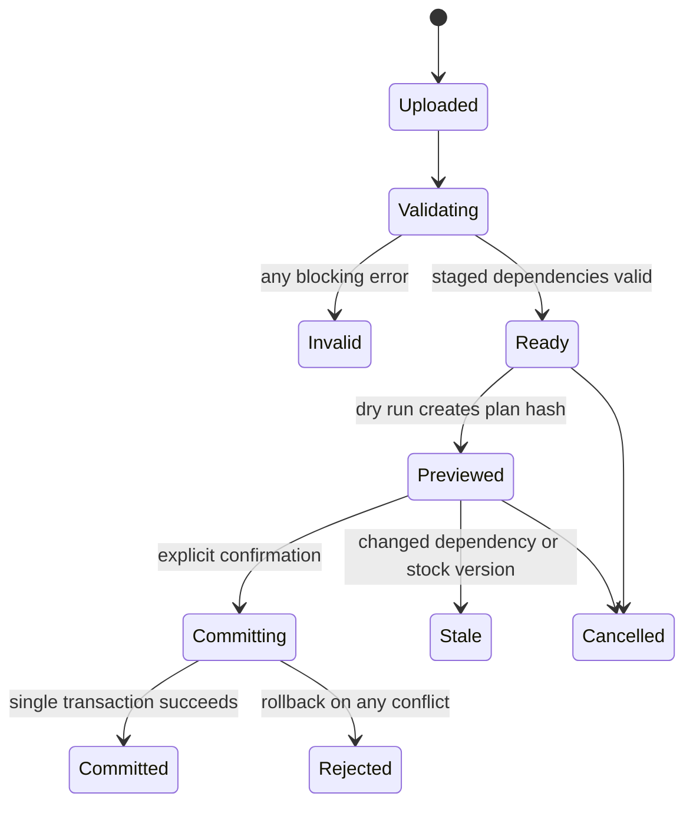

# Product CSV import — Version 1 contract

**Schema:** `retail-products-v1`. Samples contain fictional products and are intended for separate Client A and Client B demo databases. They are documentation/test fixtures, not real client catalog data. Importing is not performed in this design task.

**File rules**

- UTF-8, optional BOM accepted; comma delimiter; RFC 4180 quoting; decimal dot; no currency symbols/thousands separators; integer quantities. The supplied files use CRLF row separators.
- One header row, one data row per sellable variant. No executable formulas. All required create fields must be present. Unknown columns block import unless explicitly mapped or ignored in preview.
- Codes/SKUs are text; preserve leading zeroes. Codes use lowercase ASCII letters/digits/hyphens/underscores; SKUs may contain uppercase letters/digits/hyphens/underscores. Normalize surrounding whitespace and reject normalized duplicates. Category codes are deployment-wide stable keys.
- The import dialog supplies mode `create | update | upsert`, locale defaults, dependency-creation choice, image policy and stock mode. Currency comes from deployment settings; no per-row currency or tax column.
- Whole-file maximum 5,000 variant rows and 10 MiB. Any blocking error rejects all rows. Omitted products/variants are preserved.
- Product-level fields must be identical across rows with the same `product_code`. Variant fields may differ. CSV is data, not an implicit attribute-definition language.

| Column | Scope / create requirement | Meaning |
|---|---|---|
| product_code | Product; required | Stable grouping/import key, e.g. controller-pro; not sellable SKU |
| product_type | Product; required | simple or variable; cannot change an existing sold product's type through import |
| name_en | Product; required | English product name |
| name_ar | Product; optional for draft | Arabic name; required before publishing Arabic content |
| sku | Simple variant; required for simple, blank for variable | Sellable SKU for the one default variant |
| brand_code | Product; optional | Existing brand code, or explicit preview-approved creation |
| category_code | Product; required | Existing top-level category code, or explicit preview-approved creation |
| subcategory_code | Product; optional | Child category code under category_code; if supplied this becomes primary leaf category |
| price | Simple required; variable shared fallback optional | Exact list price; variable rows may instead all provide variant_price; a fallback is import convenience, not another product price field |
| sale_price | Simple or shared variable fallback; optional | 0 ≤ sale price < effective list price; blank means no sale fallback on create |
| cost_price | Variant; optional/private | Cost for this row's sellable item; requires catalog.cost; null if unknown |
| stock | Simple variant; required on create, blank for variable | Whole on-hand stock for simple item |
| description_en | Product; optional | Plain text or approved sanitized rich text |
| description_ar | Product; optional | Separate Arabic description |
| attributes_json | Product; optional | JSON object keyed by existing attribute code, typed values; e.g. {"wattage":12,"material":"polycarbonate"} |
| variant_attributes_json | Variable row required; simple {} | JSON object of axis code to option code; e.g. {"color":"black","connection":"wireless"} |
| variant_sku | Variable required; simple blank | Unique sellable variant SKU |
| variant_price | Variable required unless shared price provided | Overrides shared fallback for this row |
| variant_sale_price | Variable optional | Overrides shared sale fallback; explicit __NULL__ removes sale fallback for this variant |
| variant_stock | Variable required on create; simple blank | Whole on-hand stock for this row's variant |
| barcode | Variant; optional | Text; preserve leading zeroes; nonempty duplicate barcode blocks import by V1 default |
| low_stock_threshold | Product; optional | Nonnegative integer; default 5 on create; same across product rows |
| image_urls_json | Product; optional | Ordered JSON array of HTTPS public image URLs; first is primary; identical across product rows |
| variant_image_url | Variant; optional | HTTPS public image URL for this variant |
| status | Product; optional | draft by default; active requests full publication validation and catalog.publish |

**Blank/update semantics**

On create, blanks mean optional default/null as above. On update/upsert for an existing record, blank means preserve; `__NULL__` explicitly clears a nullable value. JSON `{}` clears optional descriptive values only when the user chooses replacement for that column; `[]` explicitly clears an image list. Required values cannot be cleared. For an absent column, preserve existing fields; on create enforce required fields. A nonempty shared price/sale fallback applies to imported variable rows, but row-level variant values take precedence. No hidden parent-to-variant synchronization occurs after import.

Creating a variable product infers axes only from the keys of variant_attributes_json; all rows of that product must use exactly those same keys and distinct combinations. Definitions must already be single-select and variant-eligible. Add the options used to that product's allowed-option list during the same transaction. Updating an existing product may add combinations against its existing axes, but changing axes/removing combinations is a separate previewed admin action. Maximum 250 combinations per product.

`attributes_json` uses native JSON numbers/Booleans, ISO dates, text strings, single-select option codes or arrays of multi-select option codes. Unknown definition/option, wrong type, required missing value or units embedded in a numeric value produces a field error. Units are configured on the definition. A value cannot be both a product-wide descriptive value and a contradictory variant axis.

**Sample prerequisite definitions**

Create these through the attribute admin before importing. Codes are deliberately different between the two deployments; none is a master seed default.

| Deployment | Definition | Type | Options/unit | Variant axis? |
|---|---|---|---|:---:|
| A | color | single_select | black, white | yes |
| A | connection | single_select | wired, wireless | yes |
| A | compatibility | multi_select | pc, console | no |
| A | cable_length | number | metres | no |
| B | wattage | number | W | no |
| B | voltage | number | V | no |
| B | material | text | none | no |
| B | light_color | single_select | warm, cool | yes |
| B | socket_type | single_select | e27, b22 | yes |

Client A dependency codes: brand `demo-audio`; category `gaming`; subcategory `controllers` under gaming; category `accessories`; subcategory `cables` under accessories. Client B: brand `demo-electric`; category `lighting`; subcategory `bulbs` under lighting; category `electrical`; subcategory `switches` under electrical. Assign English/Arabic display labels through admin. Dependency auto-creation is off by default; if enabled, preview must show each code, parent and approved display labels before confirmation.

Both sample files have one variable product with two rows and one simple product with one row. Arabic labels are illustrative and should be reviewed by the merchant. Images are left empty so the sample does not depend on unverified remote URLs. To exercise images, use an approved public HTTPS URL you control, e.g. the structural format `https://YOUR-PUBLIC-MEDIA-HOST/products/image.jpg` after substituting a real reachable host; this placeholder must not be imported literally.

**Lifecycle and atomicity**

Invalid/stale/rejected jobs require corrected upload or revalidation/new preview. Confirming a committed job returns the original result. Cancel cannot interrupt a transaction after commit starts; the UI reports completion/rejection and does not pretend rollback after success.

Validation covers file encoding/headers/size, required fields, JSON types, duplicate SKUs/barcodes/combos, cross-row consistency, price bounds, integer nonnegative stock, hierarchy cycles, axis completeness, required attributes, image safety and permission checks. Full dry run applies the same business validation as commit without changing catalog/inventory. Confirmation rechecks all relevant entity versions and takes deterministic locks.

Strict image policy is the default: download/validate every nonempty URL before confirmation; any failure blocks the entire import. Optional `skip_images` must be explicitly chosen in preview for the whole file; no silent per-row image loss. Fetching blocks SSRF/private IPs and revalidates redirects, limits bytes/time, sniffs MIME and scans/re-encodes supported raster formats. Staged objects remain private until referenced by committed records.

Stock modes: `preserve_existing` default; `replace_on_hand` only with inventory.adjust and reason. On create, provided stock creates an opening movement. On update, nonblank stock in preserve mode is previewed as ignored with an explicit warning. Replacement computes delta under lock and rejects on_hand < reserved + committed. A live checkout after preview makes affected replacement rows stale; the entire file must be reviewed again.

Error report columns: row_number, product_code, effective_sku, column, error_code, message, safe_original_value. Spreadsheet-dangerous leading characters are escaped in report exports. Example errors: UNKNOWN_ATTRIBUTE, WRONG_ATTRIBUTE_TYPE, DUPLICATE_SKU, CONFLICTING_PRODUCT_FIELD, INVALID_VARIANT_COMBINATION, IMAGE_FETCH_FAILED, STOCK_BELOW_ALLOCATED, STALE_PREVIEW, MISSING_PERMISSION. Error rows never constitute a partially imported catalog.

**Acceptance:** import both samples into their matching clean demo configurations. Then add an invalid final row and prove that catalog/stock/movement counts remain unchanged. Repeat confirmation with the same idempotency key and prove no duplicates. Simulate a stock sale between preview and confirmation and prove whole-file rejection for stale stock replacement.
