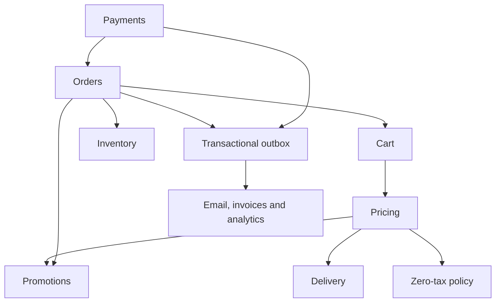
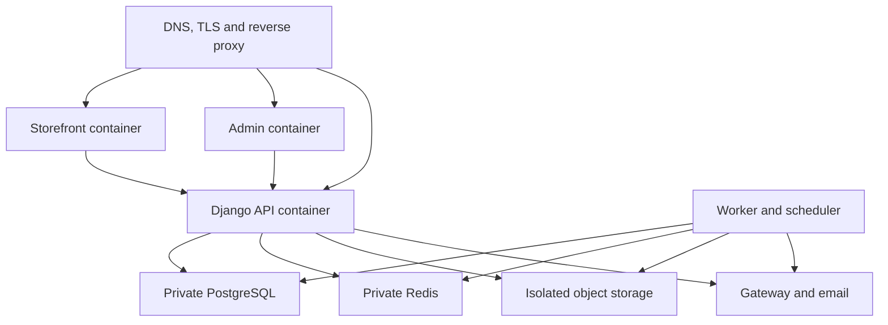
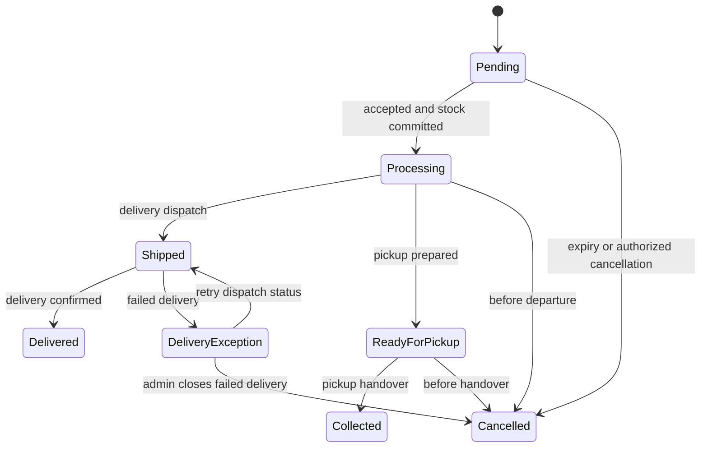

# Reusable Retail Platform — Version 1 Design Baseline

**Status:** Architecture approved; detailed design submitted for review. No production implementation authorized by this document.  
**Revision:** 1.0 — 4 October 2026  
**Principle:** BUILD ONCE → CLONE → CONFIGURE → LAUNCH.

This specification incorporates the supplied 42-section SOW, the accompanying build brief, the approved architecture, and the user's Version 1 decisions. The latest explicit Version 1 decisions take precedence. Examples are fictional demonstration data. Technical defaults below are design decisions, not descriptions of an already implemented system.

**Package contents and authority**

- `RETAIL_V1_SPECIFICATION.md`: behavior, architecture, deployment, security, testing and scope.
- `DATABASE_ERD.md`: readable, domain-scoped relationship diagrams and integrity rules.
- `DATABASE_SCHEMA.dbml`: complete application-owned entity/field/foreign-key inventory for the V1 logical design; not executable migrations.
- `API_ENDPOINTS.md`: explicit method/path/permission catalog and API conventions.
- `PERMISSION_MATRIX.md`: exact capability grants for the initial roles.
- `products_client_a.csv`, `products_client_b.csv`: valid illustrative product-import files for two separate demonstration deployments.
- `IMPORT_FORMAT.md`: column contract, sample attribute setup, atomicity and validation rules.

Database constraint notes, API contracts and state rules form one specification. Framework-owned session/MFA tables and infrastructure telemetry storage are identified separately; implementation may map those to vetted framework packages without changing behavior.

**Decision register**

| Decision | V1 baseline |
|---|---|
| Runtime model | Modular monolith API; separate storefront/admin; background worker and scheduler |
| Core stack | Next.js/React/TypeScript; Django 5.2 LTS/DRF; PostgreSQL; Celery/Redis; S3-compatible files; Docker/Nginx |
| Version policy | Pin supported compatible releases and current security patches at implementation kickoff; no floating production tags |
| Client isolation | Separate database, credentials, media boundary, admin identities, customers, orders, settings, payment configuration and domain |
| Currency/locales | One configured transactional currency; initial QAR; English and Arabic from foundation; Asia/Qatar is the initial configurable timezone |
| Tax | Disabled; all tax amounts zero; no tax-management UI or tax-rate tables in V1 |
| Stock | Whole units; one deployment stock pool; no backorders |
| Imports | Whole-file atomic catalog/inventory commit; any blocking error rejects the entire file |
| Promotions | Priority-first, one automatic discount per unit; at most one coupon and only on undiscounted units |
| Payments | COD, bank transfer, one card adapter; specific live gateway remains to be selected |
| Fulfillment | One delivery/pickup method per order; one fulfillment per order in V1 |
| Returns/refunds | Full/partial refunds; explicit independent restock; no customer returns/exchange portal |
| Branding | Runtime configuration and typed CMS sections; same immutable application images for every client |

**1. Final database/entity model**

The full ERD and DBML are included in the package. These are the binding modeling decisions:

1. Every sellable item is a `variant`. A simple product has one default variant. SKU, barcode, price, sale price, cost and inventory belong to variants. `product_code` is a stable import/grouping key, not another sellable SKU. Category hierarchy replaces separate category/subcategory table types.
2. Product-to-category is many-to-many, with exactly one primary category for reporting/navigation. A product has at most one brand. Order-item snapshots preserve the primary category ancestry and brand at sale time.
3. Attributes use typed scalar values plus controlled option selections. Text, number, Boolean, date, single-select and multi-select are supported. Variant axes use only single-select definitions. Option labels and attribute labels are translated separately from stable codes.
4. `(product_id, normalized_combination_key)` is unique. Each variant has exactly one option per selected axis; selected options must belong to that product's allowed options and to the correct attribute. The default variant has an empty combination and is permitted only for a simple product.
5. `inventory_balance` stores on-hand, reserved and committed quantities. Available = on-hand − reserved − committed. Committed stock is accepted but not yet dispatched/collected. This distinguishes a commercial sale commitment from a physical departure.
6. Orders, payments, refunds, stock movements and issued invoices are durable histories. Catalog records used by orders are archived rather than destructively deleted. PII removal is a controlled retention/anonymization operation, not cascaded order deletion.
7. All money columns use exact `numeric(20,6)` storage, validated and quantized to the deployment currency exponent. QAR uses two decimal places in the initial configuration. Persist currency and exponent with every order/payment/refund; never infer historical currency from current settings.
8. Timestamps are UTC; schedules/report boundaries use the configured IANA timezone. Validity windows are start-inclusive/end-exclusive. Slugs are unique per resource type and locale, with redirect records after changes.
9. Immutable order snapshots contain product/variant labels, SKU/options, image reference, quantity, list price, every discount allocation, tax zero, delivery charge, currency, business identity and addresses. Catalog edits cannot rewrite them.
10. Operational JSON is schema-versioned and validated: CMS section properties, rule parameters, integration public options, snapshots, analytics properties. Relationships that need foreign keys—variant options, coupon redemptions, order items—remain relational.
11. Settings have a singleton per deployment, validated revisions and audit history. Secrets are references to protected server storage, never ordinary public JSON fields.
12. UUIDs are identifiers, not authorization. Every customer query is scoped to ownership; every staff action checks a capability.

**2. API contract**

`API_ENDPOINTS.md` enumerates the V1 routes. No undocumented generic mutation route is implied. Separate route namespaces cover store, customer account, admin, webhooks and operations.

- JSON over HTTPS; version prefix `/api/v1`; UTF-8; ISO-8601 timestamps; money as decimal strings; quantities as integers.
- Locale is selected by supported locale code, never embedded bilingual strings. Public URLs include locale.
- Paginated lists: `results`, `next_cursor`, `has_more`; bounded page size, default 25, maximum 100. Sorting/filter fields are allowlisted. Facet counts come from the same filtered catalog predicate as results.
- Errors: `code`, translated `message`, optional `field_errors`, `request_id`. Validation 400; unauthenticated 401; forbidden 403; missing/private foreign object 404; stale/conflicting state 409; invalid expired quote 409; throttled 429; provider temporarily unavailable 503.
- Mutations accept an entity version or `If-Match` where stale editing is dangerous. A stale edit is rejected rather than silently overwriting another editor.
- `Idempotency-Key` is mandatory for order placement, payment attempts, refunds, collection confirmation, inventory adjustments/restocks and import confirmation. Store request hash and result; reusing a key with a different request returns 409. Retain financial keys with their records; other request keys at least 30 days.
- An order-placement request contains cart/quote references, contact/address, delivery choice and payment method. Prices, discounts, stock and totals are recalculated server-side.
- Callback routes bypass browser CSRF only because they require provider signature verification and replay protection. All session-authenticated browser mutations require CSRF, including login/session bootstrap protection.
- Cost prices, staff notes, secret references, raw gateway payloads and customer PII are absent from public serializers.
- Background operations return 202 plus a status resource. Download endpoints authorize each access and issue short-lived private URLs where appropriate.
- No browser reaches PostgreSQL, Redis, a secret store or payment credentials directly.

Public catalog responses use the current validated publication snapshot; drafts never leak through a live product route. Publishing replaces that pointer atomically. Live availability is overlaid from inventory; checkout revalidates current published prices and inventory. CMS/page/blog draft bodies live in revisions; the public renderer reads only the published revision. Global settings edits use draft settings revisions, then update effective singleton settings atomically at publish. Integration secrets are applied through audited integration commands, never content preview.

Arabic publication requires an Arabic name/title for public catalog/content entities. Optional untranslated descriptions may fall back to the default locale with an explicit language marker; UI labels never mix locales. Slug resolution/canonical redirects remain locale-specific. Pure UI translations are versioned with the master; merchant translations are database content.

**3. Permissions and authentication**

See `PERMISSION_MATRIX.md` for all initial grants. Capabilities are enforced on the backend, not merely hidden in navigation. Super Admin has all client-level capabilities; it is not a platform-wide or database superuser.

Customer and staff identities share a user identity table but have separate profiles, login contexts and sessions. Use storefront host-only session cookies on the storefront domain and admin host-only session cookies on its admin domain. Nginx proxies each origin's `/api` routes to the same backend; backend audience checks prevent a customer cookie from authorizing staff operations. Admin login requires staff membership and MFA. CORS is disabled by default because browser APIs are same-origin.

- Password hashing uses a vetted adaptive hasher; configurable minimum password length 12, password-manager/paste support, common-password rejection and no arbitrary composition rules.
- Email OTP: six digits, 10-minute lifetime, hashed challenge, five attempts, 60-second resend cooldown; account/IP throttles. Responses do not reveal whether an account exists.
- Google OAuth/OIDC validates state, nonce, PKCE where applicable, issuer, audience and verified identity claims. Linking to an existing account requires signed-in reauthentication or independently verified ownership.
- Staff invitations expire in 48 hours and carry explicit role grants; self-registration never grants staff membership. Last active Super Admin cannot be disabled or stripped of its final access.
- Staff MFA: TOTP with single-use recovery codes; recent reauthentication for secret changes, roles and refunds. No SMS dependency.
- Customer sessions expire after 14 days idle/30 days absolute; staff sessions after 30 minutes idle/12 hours absolute. Password reset/security changes revoke relevant sessions. Session identifiers rotate at login and privilege changes.
- Guest cart uses an opaque random cookie. Guest order access exchanges a verified email link for a short-lived order-scoped session; order number alone cannot retrieve PII or invoices. Guest-to-account order linking requires proof of email ownership.
- User login merges cart items subject to fresh stock/quantity validation; it does not silently preserve expired prices.

**4. Complete module dependency map**

An arrow means the row may call the named module's public service/query interface. No module writes another module's tables directly. Signals are not used as hidden commerce orchestration. Events shown are delivered from a transactional outbox after commit.

| Module | Synchronous dependencies | Owned responsibilities/events |
|---|---|---|
| common | none | IDs, time/money primitives, error contracts; no business policy |
| configuration | common | validated runtime settings, public projection, revisions; `configuration.published` |
| identity | common, configuration | users, staff, roles, challenges, sessions and audit identity |
| media | common, configuration, identity authorization | safe assets, private downloads; storage adapter |
| catalog | common, media | products, variants, category/brand/attribute model; `catalog.changed` |
| inventory | common, catalog identity queries | balances, reservations, commitments, movements; `inventory.changed`, `inventory.low` |
| customers | common, identity, catalog | addresses, wishlist, reviews; moderation |
| promotions | common, catalog | typed rules, eligibility, allocations, redemption holds |
| delivery | common, configuration | areas, methods, schedules, pickup, quotes |
| taxation | common, configuration | pure zero-tax policy; no persistence or rate management |
| pricing | common, catalog, promotions, delivery, taxation | pure quote calculation; no order/payment writes |
| cart | common, identity, customers, catalog, pricing | guest/account cart, versioned expiring quotes |
| orders | common, cart, pricing, customers, inventory, promotions, configuration | transactional placement/acceptance/cancellation/fulfillment; `order.placed`, `order.accepted`, `order.fulfilled`, `order.cancelled` |
| payments | common, configuration, orders public commands | attempts, verified transactions, refunds, reconciliation; provider adapters; `payment.captured`, `refund.succeeded` |
| content | common, media, catalog read interfaces, identity | CMS/blog/homepage/SEO; `content.published` |
| imports | common, catalog public bulk services, inventory public adjustments, media | staged CSV validation and one transaction commit |
| documents | common, orders read interface, media | immutable invoices and refund documents; consumes payment/order events |
| notifications | common, configuration, identity/contact snapshots | consumes order/payment events; email templates and delivery logs |
| analytics | common, catalog read projections | first-party events and aggregates; consumes order/payment/refund events |
| operations | common, audit/outbox/job infrastructure | health, authorized audit and job views |
| search | common, catalog read interfaces, inventory availability | search projection, facets and invalidation; consumes catalog/inventory events |

Orders do not call the payments module. Payment orchestration creates attempts against an existing pending order, then calls idempotent order acceptance commands after verified capture. The card browser flow is order placement → payment attempt, so neither module needs a circular import. COD acceptance is an order command; subsequent cash collection is recorded by payments. Refunds do not call inventory. Documents and notifications are event consumers, not dependencies needed to commit checkout.

Background jobs are at-least-once. Consumers deduplicate by event ID/business key. Redis is not the financial source of truth. PostgreSQL outbox/reconciliation permits recovery after broker loss. A scheduler lease prevents duplicate periodic schedulers.

**5. Final folder structure**

These are proposed repository paths; no application repository is created by this design task.

| Path | Contents |
|---|---|
| `apps/storefront/src/app/[locale]/` | home, shop, categories/[slug], brands/[slug], products/[slug], offers, deals, wishlist, compare, cart, checkout, auth, account/orders, tracking, blog, CMS routes |
| `apps/storefront/src/features/` | catalog, discovery, cart, checkout, account, content, analytics, WhatsApp |
| `apps/admin/src/app/` | login/MFA, dashboard, catalog, inventory, orders, customers, promotions, content, imports, settings, staff, operations |
| `apps/admin/src/features/` | domain forms/tables, previews and workflow actions |
| `packages/ui/src/` | accessible shared primitives, responsive/RTL layouts, CSS theme tokens |
| `packages/api-client/src/` | generated API types, client, error normalization |
| `packages/i18n/` | separate en/ar UI dictionaries, formatting utilities |
| `packages/config-contracts/` | public configuration and CMS section schemas |
| `backend/config/` | settings/base, environment settings, URL routing, worker/scheduler setup |
| `backend/apps/{module}/` | each module named in section 4, excluding adapter-only implementations |
| `backend/apps/{module}/api/` | serializers, views, routes, permissions |
| `backend/apps/{module}/models/` | ORM entities and constraints |
| `backend/apps/{module}/services/` | transactional commands/use cases |
| `backend/apps/{module}/queries/` | read queries and reporting projections |
| `backend/apps/{module}/policies/` | pure calculation, eligibility and transition rules |
| `backend/apps/{module}/tasks/` | explicit background task handlers |
| `backend/apps/{module}/tests/` | domain and integration tests |
| `backend/integrations/payments/` | adapter interface, registry, selected card adapter, fake test adapter |
| `backend/integrations/{email,storage,search}/` | replaceable infrastructure adapters |
| `backend/common/` | shared primitives only |
| `contracts/` | OpenAPI, JSON schemas, event contracts, CSV schema versions |
| `deployment/{containers,compose,nginx}/` | neutral runtime/deployment definitions |
| `deployment/templates/` | empty client manifest and secret-reference template |
| `scripts/` | bootstrap, migration, backup/restore, smoke checks, clean-client provisioning |
| `fixtures/demo-a/`, `fixtures/demo-b/` | explicitly synthetic catalog/branding/content, never production seed defaults |
| `tests/{e2e,contract,security,load,cloning}/` | cross-application release tests |
| `docs/{architecture,operations,onboarding}/` | versioned specification and runbooks |

Client production manifests live in separate protected deployment storage/repositories. They are not branches or folders in the master source. Package lockfiles, environment templates and release manifests are versioned; real environment secrets are excluded.

**6. Deployment architecture**

Per client: isolated database and DB user; separate media bucket or IAM-enforced prefix with separate credentials; separate Redis instance initially (or demonstrably ACL-isolated service); unique app/session/secret-encryption keys; unique admin users; gateway merchant account/webhook secret; domain and OAuth callbacks; client-specific email sender.

Nginx serves storefront and admin on different hosts and proxies each host's API path. Database/Redis ports are private. Public assets may use a CDN; invoices, exports and import files remain private. Staging has separate credentials and test gateway configuration. Staging email is allowlisted/sandboxed and search indexing is disabled.

One pinned release comprises storefront, admin, API/worker image digests plus API/schema/config versions. Runtime branding does not depend on build-time `NEXT_PUBLIC_*` client data. Server-only origin/environment data is injected at startup; public settings come from a validated runtime endpoint. Cache keys include deployment, locale and configuration/catalog revision. Private responses use no-store.

Initial operating targets (defaults, subject to hosting capability validation): daily encrypted backup plus database WAL/PITR for a 15-minute RPO; 4-hour RTO; 30-day backup retention; monthly restore rehearsal; 30-day operational logs with PII redaction. Audit/financial retention is a client policy to set before production, not an assumed legal period. If hosting cannot meet these targets, record the actual limits before launch.

Deploy migrations once as a release job, not independently from every app replica. Use expand/contract changes, backup before destructive migration, application readiness gates and rolling restart where compatible. Never promise that reverting an image reverses a database migration. Health checks verify API, worker heartbeat, database, queue lag, payment callback failures, certificate expiry, backup age and storage capacity.

**7. Client cloning procedure**

1. Choose a tested master release by digest; create a new deployment ID in the private release registry.
2. Provision an empty database and isolated storage/Redis/resources. Generate every credential afresh.
3. Set domain, TLS, allowed hosts, timezone, en/ar, default locale and currency. Tax mode is `disabled`.
4. Run schema migrations and neutral bootstrap: capability catalog, default role definitions, supported section registry and internal state definitions. No real staff/password, business identity, category, attribute or product is seeded.
5. Create the initial Super Admin through a single-use bootstrap process; require MFA enrollment and invalidate bootstrap access.
6. Configure brand assets/colors, business details, WhatsApp, email, policies, menu and homepage sections.
7. Configure delivery areas/methods/cutoffs and pickup location; configure bank/COD and the selected gateway's client-owned secret references.
8. Create/import attribute definitions and controlled options; upload a product CSV, validate/dry-run, review, confirm, and publish reviewed products. Import content/media separately through the admin.
9. Configure client-specific OAuth callbacks, gateway webhooks, email DNS and sandbox/production environment separation.
10. Run permission, catalog, Arabic, cart, payment, refund, delivery, inventory, invoice and cache-isolation smoke checks.
11. Verify backup restore, monitoring, production contacts and merchant live readiness. Switch DNS when approved for launch.
12. Record application/schema/config versions and operational ownership. Future master releases upgrade this deployment without merging a client fork.

Never copy another client's production database, media, customer files, sessions, secrets, merchant tokens or admin accounts. Optional template packs export only an explicit allowlist of non-personal configuration/content with dependencies remapped; exclude integrations/secrets and commercial histories.

**Two-client release acceptance:** deploy Client A (gaming/electronics) and Client B (electrical/accessories) from identical image digests. Give each distinct synthetic logos, colors, categories, attributes, products, area/method rules, WhatsApp test configuration and English/Arabic content. Use distinct databases, credentials, domains and media storage. Place orders in both, alter settings in A, and prove B is unaffected. Search compiled assets for brand leakage; inspect runtime configuration and media access isolation. Record image digests and the two acceptance reports. The included CSVs are sample input, not completed deployments or acceptance evidence.

**8. Product import specification**

The complete column/validation contract is in `IMPORT_FORMAT.md`. UTF-8 CSV with a header; one row per sellable variant; repeated product-level values must agree. Attribute and option codes reference preconfigured definitions. Unknown brands/categories may be explicitly proposed for creation in preview, but unknown attribute types cannot be inferred safely and block validation.

Default limits: 10 MiB, 5,000 data rows per confirmed file, 250 variants per product, 10 images per product. Limits are deployment safeguards, not catalog-size limits. Larger onboarding imports are split into independently reviewed files; no silent chunk commits inside one confirmed file.

Pipeline: upload → parse → validate entire file → resolve dependencies and stage image downloads → dry-run/preview → user confirmation of immutable plan hash → lock/revalidate → one database transaction → committed. Any invalid row, failed strict image download, stale preview, stock conflict or database error means **zero catalog, variant, media-reference or inventory changes** from that file. Validation/import-job records and inaccessible staged image objects may remain for audit/cleanup.

Confirmation binds file hash, mapping, import mode, dependency revisions and selected stock mode. Changed data invalidates preview and requires another dry run. Image downloads occur before the database transaction; no network call holds stock locks. On commit, pre-staged assets become referenced/visible. Orphan staging is cleaned after 24 hours.

Create/update/upsert modes are explicit. Default mode is create. Product identity uses stable `product_code`; sellable identity uses immutable SKU. Renaming an existing SKU is a separate audited admin action, not a CSV upsert inference. Omitted rows never delete variants. Existing stock is preserved by default; changing stock through import requires `inventory.adjust`, explicit `replace_on_hand` mode and a reason. New variants receive initial on-hand stock and an opening movement. Replacement must remain at least reserved + committed. No partial success option exists in V1.

**9. Payment adapter interface**

This is a design contract, not production code. The adapter receives trusted server-calculated values. Checkout knows payment-method IDs and normalized results, never provider-specific field names.

| Operation | Input | Normalized output / behavior |
|---|---|---|
| `capabilities` | none | supported currencies; hosted checkout; full/partial refund support; status lookup; idempotency/reconciliation capability |
| `validate_configuration` | environment, public options, secret handles | readiness errors without returning secret values |
| `create_payment` | attempt ID, merchant reference, exact amount/currency/exponent, server-approved return/cancel URLs, idempotency key, minimal payer data | provider reference, hosted redirect URL, pending/succeeded/failed, expiry |
| `retrieve_payment` | stored provider reference/merchant reference | normalized status, amount/currency, captured amount, provider timestamps |
| `verify_and_parse_webhook` | raw request bytes, allowed headers, configured secret handle | verified normalized event with unique provider event ID, reference, amounts, currency, status and event time; rejects bad signatures/replays |
| `request_refund` | captured transaction reference, refund ID, amount/currency, reason, idempotency key | provider refund reference and pending/succeeded/failed/unknown |
| `retrieve_refund` | refund reference/merchant reference | confirmed refund status and amount |

Normalized errors: validation, authentication/configuration, unsupported capability, declined, retryable transport/rate limit, and unknown outcome. A network timeout is not proof of failure. Unknown creation/refund outcomes are reconciled by reference before another money-moving request. If a provider lacks native idempotency, the adapter must demonstrate safe reference lookup/reconciliation; otherwise uncertain operations require staff review rather than blind retry.

Provider callbacks are signature-verified over the documented raw payload, deduplicated, matched to the expected deployment/merchant/reference/amount/currency, and processed transactionally. Out-of-order events cannot demote captured money to pending. A browser redirect never marks an order paid.

COD and bank transfer use the same payment ledger but separate offline method services. COD creates a collection record; staff confirms received money. Bank transfer instructions/reference are shown from configuration; authorized staff verifies funds before capture/acceptance. Uploaded transfer proof, if later added, would not itself establish payment.

Refund requests reserve refundable headroom under a payment lock: successful refunds + pending/unknown refund holds must not exceed captured amount. Offline refunds require an explicit confirmation and external transfer/cash reference before success. A recorded intention to refund is not a completed refund. Card refund support is a release acceptance requirement for the chosen adapter; where merchant/API limitations force external processing, only an audited verified external-refund path may confirm completion.

For an order, only one active card attempt at a time. Failed/expired attempts allow retry. A second unexpected capture is recorded, held for reconciliation and refunded through the ledger; it does not create a second accepted order or inventory commitment. Zero-payable orders bypass providers, are marked `not_required`, and accept normally if stock is available.

**10. Order, payment and inventory state machines**

The internal states below are fixed business meanings. Admin status labels may be translated/renamed. New visual substatuses may map to the same internal state. Arbitrary transitions or arbitrary stock/payment side effects are not editable scripts.

A status definition's internal-state mapping becomes immutable once referenced; changing a display label cannot move existing orders. Scheduled CMS publishing activates a validated revision pointer; drafts cannot overwrite currently published content. Public catalog snapshots explicitly exclude costs, staff notes and secret values.

`Delivered` and `Collected` are completed fulfillment outcomes. Cancelling after a shipment departed does not restock; staff records received goods separately. Refund status is a separate badge/history, not a replacement for order lifecycle. Full refunds before departure require order cancellation first so staff cannot accidentally fulfill an order intended to be closed. Partial refunds do not edit ordered quantities or automatically cancel fulfillment. The admin must act separately if fulfillment should stop.

| Trigger | Order/payment effect | Inventory effect |
|---|---|---|
| Place card/bank order | Pending; payment pending | Reserve quantity; on-hand unchanged |
| Card captured / bank verified | Accept to Processing exactly once | Reservation → committed; availability unchanged |
| Place COD order | Accept to Processing; payment pending collection | Reserve and convert to committed in same transaction |
| Zero-total order | Accept to Processing; payment not_required | Reserve and commit atomically |
| Card reserve expiry, default 15 min | Cancel pending order and pending promotion hold | Release reserved; late captures go to reconciliation |
| Bank hold expiry, default 24 hours | Cancel pending order unless accepted in time | Release reserved; late bank receipts require review |
| Dispatch or pickup collection | Shipped or Collected | Decrease on-hand AND committed by quantity once |
| Cancel before departure | Cancel order; financial refund still separate | Release reserved or committed; do not increase on-hand |
| Refund succeeds | Increase refunded total; append history | No stock changes |
| Admin receives and restocks departed goods | Audited restock record linked to order item | Increase on-hand; at most departed quantity less prior restocks |
| Admin stock adjustment/import | Reason and authorized ledger record | Apply explicit signed on-hand delta, preserving invariants |

Pickup collection and COD delivery completion require cash recorded as collected unless an explicit Super Admin `orders.complete_unpaid` override records a reason. Card and bank orders cannot leave Processing without captured payment, except an explicitly documented reconciliation exception handled by Super Admin. No automatic stock decrement is tied to email, browser success screens, analytics or status-label text.

Payment-attempt states: `created → pending → succeeded | failed | expired`; `created/pending → unknown` on uncertain transport; `unknown → pending | succeeded | failed | expired` after reconciliation. A provider-confirmed late success is recorded even if an attempt was locally expired; the cancelled order is not automatically reopened. Funds are refunded or resolved by staff after checking stock and customer intent.

Order payment summary: `unpaid`, `pending`, `paid`, `partially_refunded`, `refunded`, `not_required`, `review_required`; computed from immutable transaction facts and unresolved exceptions. COD debt remains unpaid/pending until actual collection. Refund request states: `requested → pending → succeeded | failed`; pending may become `unknown`; verified reconciliation resolves unknown. Failed requests release their held refundable headroom.

Inventory invariants: all quantities are whole integers; on-hand, reserved and committed ≥ 0; reserved + committed ≤ on-hand; one unique movement per business operation; deterministic lock order by variant ID; all multi-item reservations succeed or none do. Available ≤ low-stock threshold is low stock; available = 0 is out of stock. Product availability is derived across active variants. Archived variants remain valid for historical references but cannot be bought.

Reservation expiry and payment capture take the same order/reservation locks. If expiry wins, capture enters review/refund; if acceptance wins, expiry is a no-op. Pending/unknown provider operations are reconciled before duplicate requests. No reservation is held forever merely because a webhook is missing.

**11. Promotion calculation rules**

Supported kinds: product, category, brand, flash sale, deal, bundle, Buy X Get Y and coupon. A variant sale price is represented as a simple product-price candidate, not a permanently lowered base that receives another discount accidentally. List price remains the common baseline.

**Automatic priority defaults:** larger number wins; Super Admin/Manager may change priority within 1–999 with a conflict preview.

| Candidate | Default priority |
|---|---:|
| Explicit virtual bundle | 800 |
| Buy X Get Y | 700 |
| Flash sale | 600 |
| Deal | 500 |
| Product promotion | 400 |
| Variant sale-price candidate | 350 |
| Category promotion | 300 |
| Brand promotion | 200 |

1. Validate active/published status, start/end, currency, product/variant/category/brand targets, optional customer allowlist, minimum spend/quantity, stock and usage limits.
   Catalog target rows are OR-matched within the eligible scope; the optional customer allowlist is an additional AND restriction. Category scopes include descendants using the current catalog tree at quotation time. Qualifier and reward target roles are evaluated separately. Eligibility snapshots freeze those matches on the order.
2. Compute automatic candidates against list-price unit quantities. Sort by priority descending, monetary saving descending, then stable promotion ID ascending. At equal priority this makes the customer saving deterministic; higher priority may intentionally beat a cheaper offer. Admin preview shows overridden candidates.
3. Allocate each candidate to remaining unallocated units. A unit receives at most one automatic discount and cannot serve as both a qualifier and reward in another promotion. Different disjoint units may receive different automatic promotions.
4. At most one coupon code per cart. In V1 coupons discount only units with **no automatic discount**, including no sale-price discount. Admin cannot enable unlimited stacking. Product/category/brand/customer targeting and percentage/fixed/minimum/maximum/usage rules also apply to coupons. Reject with a clear ineligible reason if no units qualify.
5. Coupon minimum spend uses the coupon-eligible undiscounted merchandise subtotal. Delivery and discounted/excluded units do not count. Automatic minimum spend uses the targeted list-price merchandise before automatic allocation; selected candidate allocation must still satisfy its quantity prerequisites.
6. Apply coupon percentage or fixed amount to eligible units, capped at configured maximum and remaining eligible subtotal. No negative line/order amounts. No shipping-discount coupons in V1.
7. Discounts allocate to units with exact decimal arithmetic. Round aggregate discounts once to currency precision and distribute residual minor units by largest remainder, with stable variant/unit-index ties. Allocations sum exactly to the displayed discount.
8. After discounts, calculate delivery using net merchandise; then tax zero; then total. A quote snapshots calculation-rule version, candidates, rejection reasons, allocations, settings revision and expiry.

Bundles are virtual groups of fixed component variants/quantities. No separate bundle stock, nested bundles, configurable component substitutions or automatic cheapest-bundle solver. Customer explicitly adds a configured bundle; component availability is checked atomically. Bundle discount is allocated proportional to component list values and stored on the component order items.

Buy X Get Y: positive integer X/Y, qualifying and reward scopes, fixed percentage reward discount (100% means free), repeatable with a configured maximum applications per order (default one). Customer must add reward units; the system never silently chooses a different SKU. Qualifier/reward units cannot overlap within an application. For overlapping scopes, select the cheapest eligible reward units for which sufficient distinct qualifying units remain; ties use SKU then unit position. Discounted/consumed units cannot be reused by another rule. Show unmet reward eligibility in cart.

Global and per-customer usage counts are protected by database locks and redemption holds. Holds created during placement expire/release with pending orders. Acceptance commits usage. Cancellation/refund after acceptance does not automatically restore coupon usage in V1. Customer-specific/per-customer-limited coupons require login; ordinary public coupons support guests with global limits and abuse throttles.

**Worked cases (QAR, tax zero):**

| Case | Calculation |
|---|---|
| Conflicting product/brand offers | List 100; product 10% at priority 400; brand 20% at 200 → product wins, net 90 |
| Sale item plus coupon | Sale item 100→80; ordinary item 50; coupon 10% → discount 20 + 5; merchandise 125 |
| Coupon fixed maximum | Undiscounted eligible subtotal 30; fixed coupon 50 → coupon capped at 30 |
| Buy 2 Get 1 | Three eligible units at 40 each, X=2/Y=1/100% → 40 discount, net 80 |
| Bundle | Components 80 and 40, bundle price 100 → total discount 20, allocations 13.33 and 6.67 |
| Free-delivery threshold | List 210, discounts 20, threshold 200 → net 190 does not qualify; configured fee applies |

Refunds use original unit-level net-paid allocations. Never rerun today's promotion rules or claw back a previous free-delivery benefit when refunding an old order. Refund amount is merchandise allocation plus explicitly selected refundable delivery amount, bounded by remaining captured money. No automatic stock return or coupon reissue.

**12. Tax and delivery calculation rules**

V1 implements the user's operational requirement **tax disabled**. This is a product configuration decision, not a general assertion about every tax or every category of goods in Qatar. No live tax-law conclusion is needed to implement this baseline.

- `tax_mode = disabled`; item tax = 0; delivery tax = 0; total tax = 0.
- No tax-rate entry, tax registration validation, jurisdiction lookup or tax-inclusive/exclusive switching in V1.
- Formula: `gross_merchandise = Σ(list_price × quantity)`; `net_merchandise = gross_merchandise − allocated_discounts`; `grand_total = net_merchandise + delivery_fee`; tax fields persist zero in order/invoice snapshots.
- The tax policy interface returns a calculation result with zero allocations. Future tax-enabled deployments require a new tested module/release; configuration alone must not pretend taxes are supported.
- Currency formatting and rounding remain active even with zero tax. Discount/refund allocations are bounded and exact. A currency change is blocked in the ordinary admin after the first order/payment; controlled migration/repricing is required, preserving all historical currencies.

Delivery method eligibility is evaluated against destination, configured business timezone, working days, optional blackout dates, cutoff, minimum net merchandise and enabled status. Checkout uses server time; at the cutoff instant the cutoff is passed. Same-day/express after cutoff are unavailable, not silently sold with a different promise. Standard delivery may remain available. Pickup uses its location's opening/availability schedule.

Delivery areas use stable configured codes and belong to one zone. Shipping addresses select an area code; free-form address text does not decide fee eligibility. For each method, most-specific area rule beats zone rule, which beats the method fallback. Within a level, rule bands cannot overlap; invalid overlapping configuration cannot publish. Band lower bounds inclusive, upper bounds exclusive. Minimum amount is inclusive; free-delivery threshold is inclusive and applies only after minimum eligibility. Fee bands/free-delivery tests use discounted merchandise excluding delivery. Pickup is free in V1. Express/same-day promises, working days, fees and thresholds are configuration, never Qatar-specific source logic.

**13. Analytics event definitions**

All events carry schema version, event ID, deployment-scoped session ID where available, occurrence time, receipt time, locale and source. Browser monetary values are descriptive only; server order records are authoritative. Do not place emails, phones, addresses, OTPs, payment payloads or full unfiltered query strings in analytics.

| Event | Emission and deduplication | Required business fields |
|---|---|---|
| `product_view` | Browser after product detail becomes visible; dedupe product per page-view ID | product ID, page-view ID; variant ID optional |
| `add_to_cart` | Backend after a successful positive quantity addition; excludes failed attempts, decrements and login merge | cart mutation ID, product/variant ID, added quantity, bundle context if any |
| `begin_checkout` | Backend after first valid checkout quote for a cart version; repeated refresh is deduped | cart ID/version, quote ID, server net value and currency |
| `purchase` | Server when order first accepted: verified card/bank payment, accepted COD or zero-total acceptance | order ID, accepted time, captured/pending/not_required status, total/currency, item snapshots, attributed shopping session |

Qualified shopping session: a non-bot, non-staff, non-test first-party session that has at least one valid product_view, add_to_cart or begin_checkout event. Session ends after 30 minutes of inactivity; direct-to-checkout activity may qualify. Checkout binds the session to the order before payment redirect, so delayed callbacks retain attribution. Do not infer sessions using fingerprinting; unavailable/declined analytics consent produces an unattributed order.

**Conversion rate = unique accepted purchases attributed to qualified shopping sessions / qualified shopping sessions × 100.** Numerator is unique order IDs, not unique converting sessions. Therefore multiple orders in one session can yield a rate above 100%; display the exact label and help text rather than silently switching definitions. A separate optional converted-session percentage may be added later.

For date-filtered conversion, cohort by session start in the selected store-local period. Include accepted orders linked to those sessions within seven days of session start; show a provisional badge until that window closes. Purchases outside the window remain in total sales/orders but are reported as outside-window/unattributed for this conversion metric. Exclude bots/staff/test events from both sides. Consent-limited metrics display coverage (attributed purchases / all accepted purchases). Zero sessions → “N/A”, not 0%.

Purchase events are once per order. Failed attempts do not count; later cancellations/refunds do not erase historical conversion, but are separately visible. Client pixel retries never create another purchase event.

| Dashboard metric | Binding definition |
|---|---|
| Orders | Accepted order count by accepted_at; excludes pending/expired/test; cancellation count shown separately |
| Sales | Accepted merchandise after discounts, less pre-departure cancellation reversals; excludes delivery; reversals dated at cancellation |
| Revenue | Captured card/bank/COD amounts minus successful refunds, by ledger event date; includes collected delivery; operational collected revenue, not a statutory accounting revenue policy |
| Customers | Distinct purchasing identities on accepted orders in the period: account ID, or normalized guest email hashed for reporting; verified linked accounts deduplicate; registered-customer count shown separately |
| Best sellers | Accepted unit quantities minus cancelled pre-departure units; refunds alone do not imply returned units |
| Low stock | Current active variants where available ≤ threshold; distinguish zero stock |
| Sales by date | Sales definition above in store timezone; negative correction days are valid |
| Sales by category | Sale-time primary leaf category only; optional ancestry rollup avoids double counting multi-category products |
| Sales by brand | Sale-time brand; explicit “Unbranded” group |

Merchandise refunds are displayed alongside Sales, not subtracted twice from cancellations and refunds. Revenue already nets successful refunds. Order snapshots and immutable financial ledger are the source of truth; aggregates can be rebuilt. Raw anonymous event retention defaults to 90 days, aggregates 24 months; client retention/consent policy must be configured before live collection. No advertising pixels are required in V1.

**14. Security checklist (release gates)**

- [ ] HTTPS, host-only Secure/HttpOnly/SameSite cookies, HSTS after domain verification, CSRF on browser mutations, narrow trusted origins.
- [ ] Staff MFA, recovery-code hashing, role-change reauthentication, invitation expiry, last-Super-Admin guard.
- [ ] Customer ownership and staff capability checks on detail/list/export/download endpoints; cross-client identifiers rejected.
- [ ] OTP/login/reset throttles, generic account-existence responses, session revocation and OAuth claim/state validation.
- [ ] No client secrets in browser bundles, public settings, logs, error messages, fixtures or Git; encrypted server secret storage and per-client access control.
- [ ] Webhook signature/amount/currency/merchant verification; deduplication; reconciliation of unknown outcomes; tested callback replay.
- [ ] Atomic stock/promotion/refund limits; no negative availability, double capture acceptance or over-refund under concurrency.
- [ ] Sanitized CMS/rich text; allowlisted URL protocols; safe rendering/structured data; Content Security Policy and clickjacking protection.
- [ ] Media type sniffing, extension/size/pixel limits, malware scanning where supported; reject executable/active content; invoices/imports private.
- [ ] Import URL fetcher blocks local/private/link-local/metadata IPs, rechecks every redirect and DNS result, bounds time/bytes and accepts HTTPS public hosts only. No arbitrary internal fetch.
- [ ] CSV parsing never evaluates formulas; export/error-report cells beginning =, +, -, @, tab or carriage return are spreadsheet-escaped as text.
- [ ] SQL parameterization, bounded filtering/pagination, Unicode normalization, request/body limits and safe error handling.
- [ ] Audit identity/time/action/reason for refunds, stock, permissions, secrets, settings and import commits; redact sensitive before/after fields.
- [ ] Database/Redis private; least-privilege users and media credentials; independent demo/staging/production secrets.
- [ ] Dependency/image scans, locked dependencies, signed/checksummed release provenance; security patch runbook.
- [ ] Encrypted backups, restore rehearsal, retention controls, alerting and documented incident contacts.
- [ ] Accessibility, Arabic content isolation, cache isolation, robots controls on staging, no customer data in publicly cached pages.

**15. Testing strategy and development gates**

Tests below are planned acceptance requirements. No production tests or live integrations have been executed in this documentation task.

| Level | Required coverage |
|---|---|
| Domain/unit | Money rounding/exponents, typed attributes, variant uniqueness, scheduling boundaries, promo priority/allocations, tax zero, state guards |
| Database/integration | Foreign keys and unique constraints, complete order transactions, outbox atomicity, inventory ledger reconciliation, archive/history behavior |
| Concurrency | Last-unit two-buyers race; multi-item all-or-none stock; coupon last-use race; capture vs expiry; parallel refunds; stale CSV preview vs live sale |
| API/permission | Every endpoint's success, unauthenticated, wrong-role, wrong-owner and stale-version cases; no cost/PII leak |
| Payment contract | Fake adapter plus selected gateway sandbox: decline, timeout, unknown, duplicate/out-of-order webhook, amount mismatch, partial/full refund, late capture, second capture |
| Import | Both supplied CSVs; Arabic/quoted JSON; duplicate/conflicting rows; bad dependency; image failure; one invalid last row causes no domain writes; retry cannot duplicate; stock conflict invalidates whole file |
| Frontend E2E | Guest/password/OTP/Google, variant/filter matching, coupons/bundle/BXGY, checkout for each method, pickup/delivery, invoice, review moderation, role-based admin |
| Locale/accessibility | English/Arabic routes, RTL layout and keyboard navigation, mobile widths, forms/errors, Arabic invoice shaping, SEO metadata and hreflang |
| Analytics | Event deduplication, COD acceptance, refund non-erasure, session cutoff, cohort window, consent coverage, no division by zero, sales/category totals reconciliation |
| Security | IDOR, CSRF, XSS, malicious uploads/SSRF, throttling, auth/session boundaries, secret scanning and replay abuse |
| Performance | Initial test dataset: 10,000 products/50,000 variants; 50 concurrent browsing users/10 concurrent checkouts; catalog API p95 <500 ms and checkout internal work <1 s excluding provider; validate on selected hosting |
| Recovery/deployment | Fresh install, version upgrade, backup restore, queue outage replay, worker restart, payment reconciliation, application rollback with compatible schema |
| Two-client acceptance | Identical image digests; different industry configurations; all identity/data/media/cache/secret boundaries verified |

Performance numbers are acceptance targets to measure, not a capacity guarantee. If the chosen hosting misses them, profile and resize or document a reviewed limit before release.

| Phase | Deliverable and gate |
|---|---|
| 0 | This internally checked design package; confirm only genuine external dependencies |
| 1 | Auth/RBAC/configuration/deployment skeleton and en/ar RTL foundation; two empty isolated installs |
| 2 | Catalog/attributes/variants/basic inventory/media and atomic CSV imports; both example industries import |
| 3 | Pricing/promotions/delivery/zero-tax policies, order/inventory transactions; business-rule tests |
| 4 | COD/bank/card adapter, refunds, invoices, notifications, reconciliation; sandbox edge-case tests |
| 5 | Storefront/admin completed journeys, wishlist/compare/reviews/WhatsApp; E2E tests |
| 6 | CMS/homepage/blog/SEO, reporting and event instrumentation; bilingual content and metric reconciliation |
| 7 | Security/performance/recovery, operator runbooks and two-client same-image acceptance; release gate |

Security/localization/testing begin in phase 1, not phase 7. The table defines sequence, not a promised duration. Final schedule follows approved team capacity and gateway availability.

**16. V1 scope, exclusions and remaining approval**

Included: responsive en/ar storefront; separate professional admin; accounts/guest checkout; custom staff roles; catalog/search/dynamic facets; typed attributes/variants; one-pool stock; atomic CSV imports; orders/delivery/pickup; COD/bank/one card adapter; full/partial refunds and independent restock; all specified promotion kinds with bounded priority policy; wishlist/compare/moderated reviews; click-to-chat WhatsApp; CMS/blog/typed homepage; technical SEO; invoices/email notifications; operational dashboards/basic conversion; runtime white-label configuration; repeatable isolated deployment and two-client acceptance.

Explicitly excluded: tax-enabled calculations/rate management; unlimited promotion stacking or arbitrary promotion scripts; multi-currency checkout/FX; multiple warehouses, supplier/purchase/POS modules; backorders/preorders/fractional-weight products; full returns/exchange/warranty-claims portal; partial shipments or multiple destinations/methods per order; marketplace/multi-vendor; subscriptions; loyalty/gift cards; AI recommendations; SMS/WhatsApp API; automated WhatsApp orders; live courier/route optimization; unrestricted page builder; client-specific source forks; platform-wide tenant billing/admin; automatic legal-policy generation; customer data copied between clients; a second live card gateway; native mobile apps.

Default choices in this document do not need separate questions: all-or-nothing imports; priority-first discounts with no discounted-unit coupon stacking; 15-minute card and 24-hour bank holds; whole-unit stock; zero tax; one fulfillment; one currency; predefined sections; first-party analytics definitions; initial operational test targets.

**One commercial decision genuinely remains:** identify the first card gateway and the client's approved merchant account. Provider names alone do not establish onboarding, currency support or refund capability. Supply the selected gateway's sandbox access/documentation through a secure channel when integration begins; production credentials are a later launch input. The adapter can be designed before this decision, but a live gateway cannot honestly be called implemented or tested without it.

Before a production launch, the client must also supply its actual brand/catalog/content, payment and bank details, delivery schedule/areas, privacy/retention policy and infrastructure account. These are onboarding inputs, not additional architecture approvals.

**Implementation remains paused for review of this package.** No request to implement, deploy, invite staff, transmit notifications or connect a payment account is implied by these documents.
